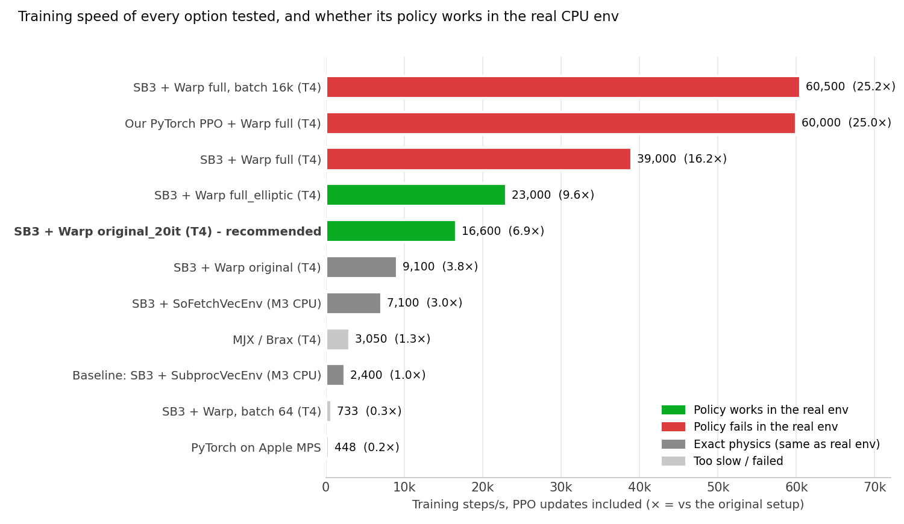

# Reinforcement learning on the SO-100 arm

The task (`SoFetchEnv`): the SO-100 arm reaches for a cube, grasps it and moves it to a target, simulated in
MuJoCo. See the HumanED notion page for installation instructions.

For imitation learning on the SO-101 with LeRobot, see [imitation_learning/](imitation_learning/README.md).

## How to train

| | Setup | Speed (training steps/s) | Policy works in the real env? | Docs |
|---|---|---|---|---|
| **Recommended** | **SB3 PPO on MuJoCo Warp, `original_20it` physics**, Kaggle's free T4 GPUs (`so_arm_warp.train_sb3`) | **16,600 per T4 (6.9× the original setup)**, two experiments per notebook | ✅ 20/20 grasps in `SoFetchEnv` | [docs/KAGGLE.md](docs/KAGGLE.md) |
| Quick sweeps | Same, `full_elliptic` physics | 23,000 per T4 (9.6×) | ✅ 20/20 (check winners) | [docs/KAGGLE.md](docs/KAGGLE.md) |
| No GPU quota | SB3 on a laptop (`train_parallel.py`, `SoFetchVecEnv`) | 7,100 (3.0×) | ✅ exact physics | below |
| Original setup | SB3 + `SubprocVecEnv` | 2,400 (1.0×) | ✅ | below |



**Faster isn't always better.** Warp's `full` physics trains at 39–61k steps/s, but its policies fail in the real env:
0/20 grasps with the most likely action. Its cheaper friction model (pyramidal cone) is the cause. Our own PyTorch PPO
on Warp (60k steps/s) never learned to grasp. On one T4 with the `default` reward, SB3 + `original_20it` learns the
grasp in ~25 min (~25M steps). No setup has carried the cube to the goal yet, so that's the next problem, and it's
about the reward rather than speed. Every measurement, including what failed (MJX, TPU, Apple Metal), is in
[docs/TRAINING_OPTIONS.md](docs/TRAINING_OPTIONS.md).

### GPU training: SB3 on MuJoCo Warp (recommended)

- **On Kaggle:** either click through [`kaggle_train_warp.ipynb`](kaggle_train_warp.ipynb) or send jobs with
  `python tools/kaggle_job.py submit ...`. Both are step by step in [docs/KAGGLE.md](docs/KAGGLE.md).
- **On any NVIDIA machine:**
  ```bash
  pip install mujoco==4.0.1 mujoco-warp==4.0.1 stable-baselines3==2.7.0 gymnasium==1.0.0 torch
  python -m so_arm_warp.train_sb3 --run-name me-1 --hours 2      # --physics full_elliptic for quick sweeps
  ```
  Checkpoints use `train_parallel.py`'s layout: `warp_sb3_out/models/<run>/<steps>.zip` plus
  `warp_sb3_out/vec_norm_stats/<run>/<steps>.pkl`, with `log.csv` and tensorboard under `warp_sb3_out/logs/`.
  `--resume <...>/final.zip` continues a run.
- **From `train_parallel.py`:** set `vec_env_backend = "warp"`. It uses the same PPO, callbacks and saving as before,
  with `SoFetchWarpVecEnv` (`so_arm_warp/sb3_vec_env.py`) in place of the CPU envs.
- **Reward experiments:** add a class to [`so_arm_warp/rewards.py`](so_arm_warp/rewards.py) and pass `--reward <name>`.
  `default` is exactly `SoFetchEnv`'s current reward (checked by `tests/test_warp_reward.py`); `legacy` is the pre-PPO7 one.
- **Physics (`--physics`):**
  - `original_20it` (default): `SoFetchEnv`'s model and solver with 20 iterations instead of 100.
  - `full_elliptic`: 1.4× faster, also transfers.
  - `original`: exact, 1.8× slower.
  - `full`: fastest, but **don't train on it**.

  `python -m so_arm_warp.sb3_bench` measures speed.
- **Check a model in the real CPU env (no GPU needed):**
  `python -m so_arm_warp.eval_sb3 warp_sb3_out/models/<run>/final.zip [--sampled] [--video out.mp4]` (video works on macOS, not on Kaggle).
  `visualise_model.py` and `evaluate_model.py` also work once the files are copied into `models/` and `vec_norm_stats/`.

### CPU training with Stable-Baselines3 (no GPU quota)

- **Laptop:** `python train_parallel.py` (set the run name at the top). It trains with `VecMonitor` + `VecNormalize`
  and saves `models/<run>/` and `vec_norm_stats/<run>/`. By default it runs 32 envs in one process with
  `SoFetchVecEnv`, which uses MuJoCo's multithreaded rollout and gives the same observations, rewards and infos as
  `SubprocVecEnv` (`tests/test_vec_env.py`). Set `vec_env_backend = "subproc"` for one process per env.
- **Kaggle CPU (no quota):** upload [`kaggle_train.ipynb`](kaggle_train.ipynb) through the website with
  **Accelerator: None**. Rebuild it after changing the env with `python make_kaggle_notebook.py`.
- **Watch a model:** `python visualise_model.py` (set the model at the top).
- **Tests:** `pytest tests/`. They check `SoFetchVecEnv`, the Warp scene and reward, and the SB3 Warp adapter against
  `SoFetchEnv`. The Warp tests need `mujoco-warp` and run on CPU if there's no GPU.

## Repository layout

| Path | What it is |
|---|---|
| `so_arm_rl/` | The original CPU env (`SoFetchEnv`) and `SoFetchVecEnv`, which runs N copies in one process |
| `so_arm_warp/` | GPU training: `train_sb3.py` (recommended), `sb3_vec_env.py` (SB3 adapter), `eval_sb3.py`, `rewards.py`, `env.py`, `physics.py` (physics options), `scene.py`, plus `sb3_bench.py` / `bench.py` / `fidelity*.py`. `ppo.py` / `train.py` / `play.py` are our own PyTorch PPO, kept for reference |
| `tools/kaggle_job.py` | Send, monitor and download Kaggle training jobs from the command line |
| `kaggle_train_warp.ipynb` / `make_kaggle_warp_notebook.py` | Kaggle GPU notebook (SB3 on Warp; clones the code from GitHub) and its generator |
| `kaggle_train.ipynb` / `make_kaggle_notebook.py` | Kaggle CPU notebook (code embedded) and its generator |
| `train_parallel.py` / `visualise_model.py` / `evaluate_model.py` | SB3 training (CPU, or GPU with `vec_env_backend = "warp"`), viewing and evaluation |
| `tests/` | `SoFetchVecEnv`, the Warp scene and reward, and the SB3 Warp adapter checked against `SoFetchEnv` |
| `docs/` | [Training options and measurements](docs/TRAINING_OPTIONS.md), [Kaggle guide](docs/KAGGLE.md) |
