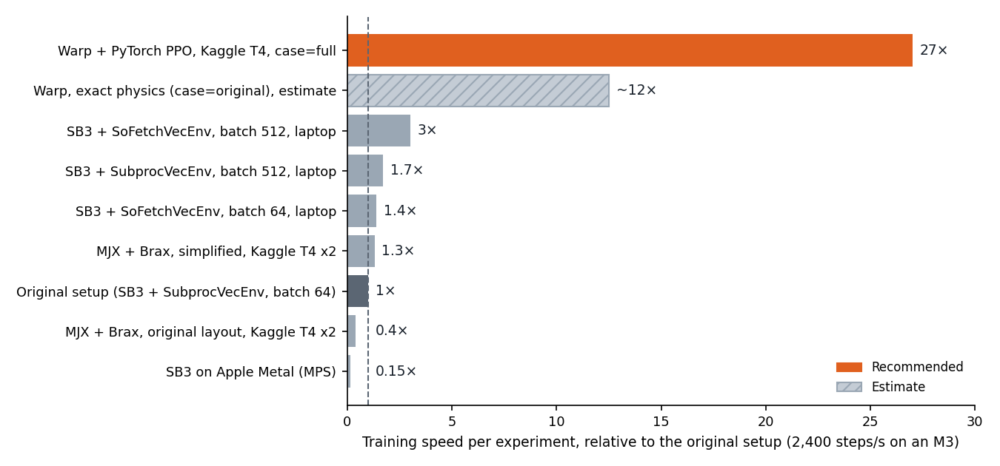

# Training speed: options we tested

How fast can we train the SO-100 fetch task, and where? Everything below was measured in November 2026,
on an Apple M3 laptop (8 cores) and on free Kaggle notebooks (2× NVIDIA T4 GPUs, or a 4-core CPU).

**Bottom line:** train with **MuJoCo Warp on Kaggle's free T4 GPUs** (`so_arm_warp/`). It runs about
**27× faster per experiment** than our original laptop setup, and each Kaggle notebook trains two experiments at
once, one per GPU. It can use all of the original collision shapes, and every physics option passed the grasp test.
For running it, see [KAGGLE.md](KAGGLE.md).

**Measured before the PPO7/PPO8 changes on `main`:** 11 action bins, the older reward, and the scene without the
two jaw sites. The physics (masses, joints, collision shapes, solver) is unchanged, so all speeds and fidelity results
still apply. Everything on `warp-training` now trains `main`'s current task. `SoFetchVecEnv` and the Warp
`default` reward are checked against `SoFetchEnv` by the tests in `tests/`.

**Baseline ("1.0×"):** the original setup, `train_parallel.py` with SB3 PPO, 8 `SubprocVecEnv` workers and
batch size 64 on the M3, at **2,400 training steps/s** (counting the PPO updates).

## A. Training throughput

This is the number that decides how long training takes.

| # | Approach | Hardware | Physics | Training steps/s | vs baseline | Status |
|---|---|---|---|---|---|---|
| 1 | **MuJoCo Warp + PyTorch PPO** (`so_arm_warp`) | Kaggle T4 ×2 (free, ~30 GPU-hours/week each) | All original collision shapes, cheaper solver (`--case full`) | **65,000 per T4 = 130,000 per notebook** (2 experiments) | **27× per experiment** | ✅ Recommended. Learned to reach the cube in 15 min |
| 2 | MuJoCo Warp + PyTorch PPO, exact physics | Kaggle T4 ×2 | Exactly the CPU env's physics (`--case original`) | ~25–35k per T4 (estimated from 43k physics-only) | ~10–15× | ✅ Physics verified; training speed not yet measured |
| 3 | SB3 + `SoFetchVecEnv`, batch 512 | Any laptop | Exact original | 7,100 | 3.0× | ✅ Free fallback, no quota |
| 4 | SB3 + `SoFetchVecEnv`, batch 64 | Any laptop | Exact original | 3,300 | 1.4× | ✅ |
| 5 | SB3 + `SubprocVecEnv`, batch 512 | Any laptop | Exact original | 4,100 | 1.7× | ✅ Batch-size change only |
| – | **Baseline:** SB3 + `SubprocVecEnv`, batch 64 | M3 laptop | Exact original | **2,400** | 1.0× | Original setup |
| 6 | Kaggle CPU notebook (`kaggle_train.ipynb`) | Kaggle CPU, 4 cores (free, no quota) | Exact original | Not measured; likely about half a laptop | ~1–1.5× (est.) | ⚠️ Tested locally, not yet on Kaggle |
| 7 | MuJoCo MJX + Brax, simplified collisions | Kaggle T4 ×2 | Simplified, 20 solver iterations | 3,050 | 1.3× | ⚠️ Works but slower than a laptop. Dropped (on branch `carlgpu`) |
| 8 | MuJoCo MJX + Brax, original collision layout | Kaggle T4 ×2 | 10 solver iterations | ~1,000 | 0.4× | ❌ Too slow, and 10 iterations dropped grasped cubes |
| 9 | SB3 with PyTorch on Apple Metal (MPS) | M3 GPU | Exact original | 217–448 | 0.1–0.2× | ❌ Each step's round trip to the GPU costs more than the small network saves |

## B. Physics/env speed only, including dead ends

| Approach | Env steps/s | Status |
|---|---|---|
| **Warp, one T4:** simplified / filtered / full / exact original | **170k / 156k / 127k / 43k** | ✅ |
| **Warp, both T4s:** full / exact original | **273k / 95k** | ✅ Scales about 2.15× |
| `SoFetchVecEnv` (all envs in one process, MuJoCo's threaded `rollout`), M3 | 20,500 | ✅ |
| `SubprocVecEnv`, 8 processes, M3 | 8,900–16,300 | Baseline |
| Thread-pool vec env (a Python thread per env) | 7,100–8,300 | ❌ No faster than processes (Python's lock, waiting on the slowest env) |
| MJX on one T4: original layout / simplified collisions | 553 / 2,100 | ❌ / ⚠️ Collision detection was ~95% of the cost |
| MJX on the M3 CPU (JAX) | 26–36 | ❌ 100× slower than plain MuJoCo |
| MJX on Apple Metal (`jax-metal`) | – | ❌ Missing operations, then a compiler crash; the plugin is unmaintained |
| Kaggle TPU v5e-8 | – | ⏳ Never got through the queue. Moot now: Warp is NVIDIA-only and already wins |

## C. Physics options for Warp (`--case`)

Each option is compared with the exact original physics on CPU MuJoCo (`python -m so_arm_warp.fidelity`).

| `--case` | Speed (1 T4, physics) | Jaw drift in random motion (median) | Grasp & hold | Gripper pushes cube (original: 4.1 cm) | Arm-into-floor / cube-into-gripper leaks (original: 1.3% / 0.3%) |
|---|---|---|---|---|---|
| `original` (exact) | 43k | **0.85 cm** | ✅ Held | 4.0 cm | 1.2% / 0.3% |
| `full` (default) | 127k | 4.2 cm | ✅ Held | 5.8 cm | 1.2% / 0.0% |
| `filtered` | 156k | 6.2 cm | ✅ Held | 5.8 cm | 1.2% / 0.0% |
| `simplified` | 170k | 6.5 cm | ✅ Held | 5.6 cm | 1.6% / 0.0% |

- **`full` keeps every original collision shape** and only uses a cheaper contact solver: a pyramidal friction cone and 20 iterations instead of 100. `filtered` and `simplified` also drop collision checks that don't matter for the task. Masses, joints and motors are identical in every case.
- **The drift column measures sensitivity, not error.** Contact-heavy random motion is chaotic, so tiny differences grow. The tests that represent the task (grasp, push, leaks) all pass.

## Caveats

- **Only speed is compared.** Warp uses continuous actions and our own PyTorch PPO, while SB3 uses 64 discrete action steps per motor. We haven't yet compared how many steps each needs to actually solve the task.
- **PPO settings are untuned,** and the longest Warp training run so far is 15 minutes.
- **Two reward problems from the old env are fixed on `main` (PPO7/PPO8).** The +20 grasp bonus used to be unreachable: it needed the cube centre within 4 mm of `jaw_site`, which sits 1.4 cm from the fixed jaw's pads. Bonuses were also paid only once per worker lifetime. The current reward uses a 3 cm, jaws-open grasp check and re-arms the bonuses every episode. Warp's `default` reward is that same reward, and `legacy` keeps the old one for comparison.

## Recommendation

1. **Main workflow: Warp on Kaggle T4 ×2 with `--case full`.** Each person runs two reward experiments per notebook, using their own free weekly GPU hours.
2. **Confirm the best policies on the exact physics:** train or evaluate with `--case original`, or play them back with `python -m so_arm_warp.play <checkpoint> --physics original`.
3. **Free fallback:** `SoFetchVecEnv` (`train_parallel.py`) on a laptop or Kaggle CPU. That's 3× the baseline, exact physics and no quota.
4. **Dropped:** MJX/Brax (kept on branch `carlgpu`), TPU, Apple Metal, and the thread-pool env.
